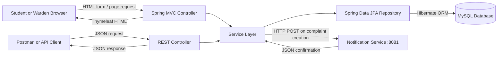

# Architecture

The main application uses Spring MVC for web pages and REST controllers for JSON requests. Both controller types use the same service and repository layers.

## Request flows

- Web: Browser form → MVC controller → service → repository → MySQL → Thymeleaf response.
- REST: HTTP request → REST controller → service → repository → MySQL → JSON response.
- Notification: Main application → HTTP request → independent Notification Service → confirmation response.

## Layers

1. **Controller:** accepts and validates web or API input, then delegates work.
2. **Service:** contains complaint and feedback logic.
3. **Repository:** uses Spring Data JPA to read and write entity data.
4. **Entity:** maps Java objects to database tables through Hibernate.

The complaint and feedback screens and API belong to one main Spring Boot application. The Notification Service is a second, independently runnable application on port `8081`; it receives an HTTP request and returns a confirmation. If it is stopped, a complaint submitted through either the API or web form remains saved.

## Monolith and microservices

A monolith packages application features into one deployable service. The main complaint application is a small monolith. A microservice architecture separates responsibilities into independently runnable services; this project separates the notification endpoint for demonstration.

Spring Cloud provides optional tools for distributed applications, such as service discovery, centralized configuration, and gateways. This project intentionally uses a configured local URL and does not add Spring Cloud infrastructure.
